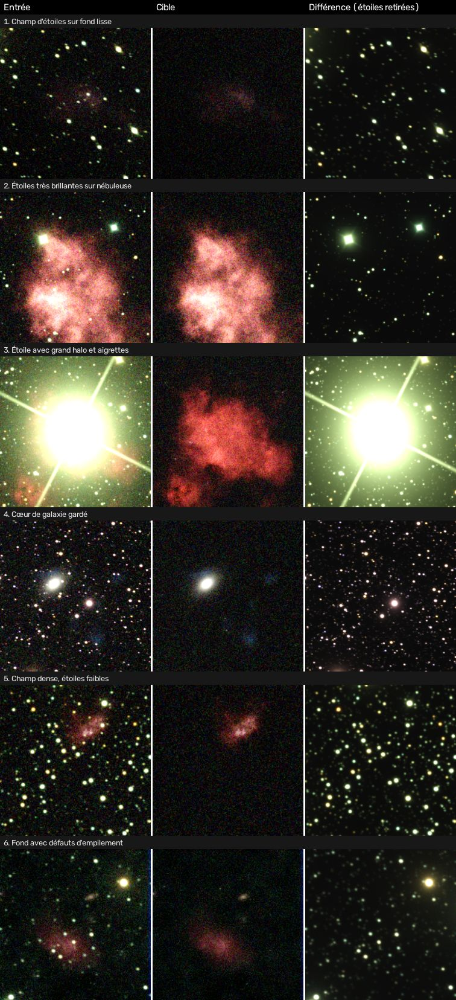

# Retrait d'étoiles par réseau de neurones, entraîné sans logiciel tiers

Dépôt de Nicolas qui documente, date et permet de refaire la méthode de retrait d'étoiles de FLOAT : un réseau NAFNet qui sépare une image astronomique linéaire en « image sans étoiles » et « étoiles seules ».
Le travail a été conduit par Nicolas avec un assistant d'intelligence artificielle (Claude, Anthropic) qui orchestrait des agents de calcul ; les consignes données aux agents sont publiées dans `prompts/`.
Les dates réelles du travail : 7 à 9 novembre 2026 pour les réseaux entraînés sur données synthétiques seules (E2, E3), 20 à 26 novembre 2026 pour la chaîne classique, les paires réelles et les réseaux N2 à N9. Ce dépôt a été constitué le 26 novembre 2026.

## L'idée en cinq lignes

1. **Pourquoi un réseau.** Retirer les étoiles « à la main » (soustraire un modèle, reboucher) est lent, fragile et demande un réglage par image ; un réseau le fait en quelques secondes sur n'importe quelle image linéaire, une fois entraîné.
2. **Où trouver des cibles sans outil tiers.** Un réseau a besoin de paires « image avec étoiles / même image sans étoiles ». Nous les fabriquons de deux façons que nous maîtrisons entièrement : (a) **synthétiques** : on génère d'abord le fond du ciel (nébuleuses, galaxies, bruit), puis on y pose des étoiles dessinées par l'optique ; la cible est le fond : elle est exacte par construction ; (b) **réelles** : on soustrait de vraies images un modèle d'étoile calculé à partir du catalogue Gaia, puis on rebouche les restes ; un juge met un poids 0 là où la méthode échoue.
3. **Pourquoi Gaia.** Le catalogue Gaia donne la position et l'éclat de chaque étoile (jusqu'à la magnitude G 21) : on sait donc exactement où retirer et combien, au lieu de deviner ce qui est étoile ou nébuleuse.
4. **Ce que cela garantit.** Aucune cible, aucun fond d'entraînement ne vient de la sortie d'un autre logiciel de retrait d'étoiles. Les empreintes de chaque fichier de paire et un script de vérification le permettent de le contrôler (`docs/PROVENANCE.md`, dossier `provenance/`).
5. **Ce que ce n'est pas.** Ce n'est pas un réseau parfait : deux modèles publiés, chacun avec un point faible connu, et des limites assumées (plus bas et `docs/AMELIORER.md`).

## Ce que le réseau apprend

Image : six exemples **synthétiques**, fabriqués par `exemples/generer_exemples.py` avec des graines fixes. Chaque ligne : entrée (avec étoiles) | cible (sans étoiles) | différence (= les étoiles retirées), même étirement.



La légende complète (graines, paramètres) est dans `docs/images/LEGENDES.md`. En bref : le fond est fabriqué en premier, puis on y ajoute des étoiles. La cible est ce fond, copié tel quel (le script le vérifie), avec le même bruit que l'entrée : elle est donc exacte par construction, et aucun logiciel n'a servi à la calculer.

## Le procédé, étape par étape (schéma)

```
 (1) E2/E3  données 100 % synthétiques (backgrounds.py, stars.py, psf.py, make_dataset.py)
        |   train_e.py : NAFNet, tuiles 256, perte L1 sur un étirement asinh fixe
        v
   modèle E3 (pas 20000)  ------------------------------------------------------+
                                                                                  |
 (2) chaîne classique v33b : soustraction guidée par Gaia + rebouchage            |
     images réelles (Nicolas) + images web délinéarisées                          |
        |  piste 1 (modèle d'étoile et de halo) -> étape A -> étape B -> juge     |
        v  scripts/Methode v33b, Juge v33, Production v33                         |
   paires réelles .npz (entrée, cible, poids)   v33d                              |
        |  v33g : lumière diffuse lente remise dans la cible                      |
        v                                                                         |
 (3) étoiles synthétiques réalistes (Etoiles synthetiques, recette N2) -----------+
 (4) cœurs de galaxie synthétiques (N7)                                           |
        |                                                                         v
        +------------------> affinage depuis E3 : train_n56.py (N5), train_n7.py (N7)
                                          |
                                          v
 (5) mélange de poids N7/N5 0,75 (chaine_melanges.py)
 (6) inférence : image entière par tuiles ; zones des grosses étoiles (G < 6,5) à deux échelles (V2)
```

Détail de chaque étape, du pourquoi et des paramètres : `docs/METHODE.md`. Ce qui a échoué : `docs/LECONS.md`.

## Résultats (nos mesures)

Mesures sur 13 images de validation jamais vues à l'entraînement, inférence à deux échelles V2 (protocole : `docs/VALIDATION.md`). Plus bas = mieux, sauf la colonne cœurs (idéal 1).

| modèle | étoiles restantes G < 8 | G 8-11 | G 11-14 | G 14-17 | fond méd. | fond p99 | structure méd. | cœurs |
|---|---|---|---|---|---|---|---|---|
| N5 | 0,000 | 0,017 | 0,072 | 0,265 | 0,0011 | 0,07 | 0,007 | 0,192 |
| N7 | 0,021 | 0,020 | 0,094 | 0,283 | 0,0023 | 0,03 | 0,004 | 0,813 |
| mélange N7/N5 0,75 | 0,021 | 0,023 | 0,090 | 0,295 | 0,0018 | 0,03 | 0,003 | 0,798 |

Tous les tableaux nettoyés sont dans `resultats/`. Lecture : « étoiles restantes » = part du flux d'une étoile qui reste après retrait, aux positions Gaia (0 = retirée) ; « fond » = écart sur le ciel loin des étoiles, en unités de bruit (0,001 = mille fois sous le bruit : invisible) ; « cœurs » = rapport de flux avant/après sur des cœurs de galaxie (le cœur doit rester : 1 = intact).

### Deux modèles, deux cas d'usage (un compromis, pas un meilleur modèle)

- **N5** (avec l'inférence à deux échelles) retire les étoiles brillantes et moyennes, y compris celles à cœur saturé de faible rapport signal/bruit (cas de la Tête de Cheval). **Mais il efface les cœurs de galaxie** (cœurs 0,19) : il les prend pour des étoiles.
- **N7** et le **mélange N7/N5 0,75** gardent les cœurs de galaxie (≈ 0,8) **mais gardent aussi des étoiles brillantes saturées de faible rapport signal/bruit** (crête plate à une centaine de fois le bruit, poses courtes) : ils les prennent pour des cœurs, car les cœurs synthétiques de N7 incluent des cœurs écrêtés de 50 à 5000 bruits.
- Notre jeu de validation ne contenait pas d'étoiles saturées à un niveau aussi faible : c'est pourquoi le tableau ne le montrait pas. Ce conflit « étoile saturée / cœur compact » est la première piste d'amélioration (`docs/AMELIORER.md`).
- Sur une image réelle de la Tête de Cheval (pile linéaire de 704 poses de 15 s, non débruitée, avec Alnitak), le mélange N7/N5 laisse visibles plusieurs étoiles brillantes et moyennes (cœur et aigrettes) ; les grandes zones de nébuleuse et la Tête sont bien conservées. Cause établie par le diagnostic du 26 novembre : N7 garde ces étoiles saturées à ≈ 108 bruits ; N5 seul les retire ; le mélange 0,75 se comporte comme N7. Aucune image de ce test n'est publiée.

### Limites honnêtes

- **Petites galaxies compactes effacées** : sur un jeu de contrôle de 18 petites galaxies (1,2 à 2,8 fois la largeur des étoiles), N7 et le mélange n'en gardent presque aucune (médiane ≈ 0) ; un logiciel tiers de retrait d'étoiles les efface aussi (vérifié le 26 novembre). La forme seule ne suffit pas à les distinguer d'une étoile.
- **Étoiles faibles G 14-17** : de 26 % à 30 % de leur flux restent .
- **Étoiles saturées de faible signal / cœur compact** : voir plus haut.
- Sous un cœur saturé, aucune vérité n'existe dans l'image : dans les paires réelles, la cible y est un remplissage plausible (niveau du pourtour, grain du ciel), pas la réalité ; les grosses étoiles sont apprises surtout par la synthèse.

## Reproduire

Matériel de référence : une carte graphique de 16 Go (RTX 4060 Ti) pour l'entraînement ; le processeur suffit pour l'inférence (lent) et pour les exemples. Durées mesurées : un entraînement de 34 500 pas ≈ 5 h (≈ 9 minutes pour 1 000 pas) ; un tour court de 10 000 pas ≈ 1 h 30 ; l'inférence sur une grande image ≈ 13 s sur la carte (M45, tuiles de 1024 px, mesure de l'application), de 2 à 3 minutes pour une image couleur de 12 Mpx sur un processeur de 8 cœurs.

### 1. Environnement

Testé avec Python 3.12.13, torch 2.11.0, numpy 2.5.3, scipy 1.18.1, OpenCV 5.0.0 (voir `requirements.txt`).

```
python -m venv .venv
.venv/Scripts/activate          # Linux/macOS : source .venv/bin/activate
pip install -r requirements.txt
```

### 2. Télécharger les modèles (fichiers de la page Releases du dépôt : plus de 90 Mo chacun, donc hors git)

Quatre fichiers `.pt` de 117 Mo : `E3_step_20000.pt`, `N5_pas_23000.pt`, `N7_pas_22000.pt`, `N7N5_075.pt` (mélange). Vérifier leurs empreintes avec `modeles/SHA256SUMS` :

```
cd modeles && sha256sum -c SHA256SUMS
```

### 3. Retirer les étoiles d'une image à soi

Une image **linéaire** (empilement calibré, ciel non étiré), couleur, en `.fits`, `.tif` ou `.npy` :

```
python scripts/inferer_une_image.py mon_empilement.fits --poids modeles/N7N5_075.pt --sortie sortie/
```

Écrit `sortie/starless.tif`, `sortie/stars.tif` (linéaires) et `sortie/apercu.jpg`. Pour une image où l'on sait qu'il n'y a pas de cœur de galaxie ou de nébuleuse planétaire compacte (champ stellaire, nébuleuse), `--poids modeles/N5_pas_23000.pt` retire mieux les étoiles saturées (en une seule échelle, N5 laisse encore les plus grosses, comme la G 3,8 de la Tête de Cheval : pour elles, utiliser l'inférence à deux échelles de `scripts/Portée M27 – 25 nov/deux_echelles_v1v2.py`, qui demande l'extrait Gaia de l'image). Tutoriel complet sur une image publique : `docs/TUTORIEL.md`.

### 4. Refaire les données et un entraînement

- **Données synthétiques** (rien à télécharger) : `python scripts/make_dataset.py --n 500 --seed 1 --sets clean,defects --workers 6 --out donnees/pairs` puis `--verify 3` pour contrôler les empreintes ; images d'exemple : `python exemples/generer_exemples.py`.
- **Entraînement synthétique (E3)** : `python scripts/day_e3.py` (voir `docs/METHODE.md`, étape 1).
- **Affinage sur paires réelles (N5, N7)** : `python "scripts/Tours N5 N6 – 25 nov/train_n56.py" --tag N5 --suffixe v33g --n2` puis `python "scripts/Tour N7 – 25 nov/train_n7.py" --tag N7 --suffixe v33g --n2 --coeurs 0.25`. Les paires issues des images de Nicolas sont en pièce jointe de version ; celles des images web se refont depuis leur page publique avec `provenance/refaire_paires_web.py` (leurs pixels ne sont pas publiés).

Ce qui dépend de l'application FLOAT et n'est pas fourni (résolution astrométrique hors ligne, lecteur de catalogues locaux, réseau de débruitage) : voir `scripts/LISEZMOI.md`. L'inférence (étape 3) n'en dépend pas.

## Contenu du dépôt

| dossier | contenu |
|---|---|
| `docs/` | `METHODE.md`, `LECONS.md`, `VALIDATION.md`, `PROVENANCE.md`, `TUTORIEL.md`, `AMELIORER.md`, `SOURCES_WEB.md`, `images/` |
| `scripts/` | tous les scripts réellement utilisés, avec `LISEZMOI.md` (quel script, quelle étape) |
| `exemples/` | génération reproductible des images d'exemple synthétiques |
| `modeles/` | empreintes et notice de téléchargement des modèles |
| `provenance/` | manifeste des paires d'entraînement, vérifications, analyse statique |
| `prompts/` | les consignes données aux agents de la lignée publiée (un fichier par consigne, par jour) |
| `resultats/` | tableaux de mesures nettoyés |

## Licence

Code, documents et modèles : GPL-3.0 (texte complet dans `LICENSE`).
Copyright (C) 2026 Nicolas
Les images web citées dans `docs/SOURCES_WEB.md` appartiennent à leurs auteurs et ne sont pas redistribuées.
