# Removing stars from linear astronomical images with a network trained without any third-party star remover

**Nicolas** · 27 November 2026 · code, data recipes, models and figures in this repository (AGPL-3.0)

*AI statement.* This work was conducted by Nicolas with an AI assistant (Claude, by Anthropic) that orchestrated computing agents; the instructions given to the agents are published verbatim in [`prompts/`](prompts/README.md).

## Abstract

Existing star-removal tools are closed image-to-image networks trained on undisclosed data. We describe an open alternative, a NAFNet that splits a linear astronomical image into a starless image and a stars layer, in which the origin of every training target is known and checkable. Targets come from two sources only: synthetic images, where the target is the background itself and is exact by construction, and real images, where the target is made by our own classical, Gaia-guided star subtraction followed by a rule-based judge that gives weight 0 to the zones where that chain failed. Fine-tuning on these pairs, adding synthetic galaxy cores, averaging weights and using a two-scale inference for the halos of the brightest stars give models that leave, over 13 validation images, 0 to 4 of 144 stars brighter than G = 8 and about 4 % of the stars of G 11-14 with more than 10 % of their flux, at a background damage of about 0.002 noise units. The variants that keep galaxy cores (0.80 of their flux on average, but 0.04 for one compact core) pay with saturated faint stars taken for cores. We report all discarded variants and three failures: saturated faint stars kept, compact galaxies erased, and faint stars (G 14-17) of which a fifth to a quarter still leave a visible residue. Our classical chain, measured on nine 512 px crops with a metric that favours it (Gaia positions, and it made the training targets), is as good as the networks on faint stars and about 17 times slower on processor.

---

## At a glance (for non-specialists)

1. **The goal.** Take a photograph of the sky in which stars hide a nebula or a galaxy, and produce two pictures: the same photograph without the stars, and the stars alone. Added together they give back the original.
2. **The difficulty.** A computer must decide what is a star and what is part of a nebula or a galaxy. A neural network can learn to do this, but only from many examples of "image with stars / same image without stars".
3. **Where the examples come from.** We make them in two ways. In the first, we *draw* a sky (nebulae, galaxies, noise), then add stars to it: the sky without stars is known exactly. In the second, we take real photographs, ask the Gaia star catalogue where every star is and how bright, subtract a computed model of each star and refill what is left; a rule-based judge marks the places where this failed so that the network ignores them.
4. **What this guarantees.** No example comes from the output of another star-removal program, and every file can be traced and checked (see [Provenance](#7-provenance-and-reproducibility)).
5. **What it is not.** It is not perfect. Faint stars (magnitude G 14 to 17) still leave a trace in roughly one case out of five to four, a saturated faint star can be taken for a galaxy core and kept, and very small galaxies are erased. We show these failures.

**Which model?** `N7N5_075.pt` keeps galaxy cores (use it for galaxies and planetary nebulae); `N5_pas_23000.pt` removes more stars but erases galaxy cores (use it for star fields and nebulae without compact cores). The others (E3, N7) are intermediate steps.

**Words used below.** *Linear image*: pixel values proportional to the light collected, before any stretch. *Noise unit*: the pixel value divided by the noise of the empty sky (the sky is 0). *Gaia*: the European star catalogue with the position and brightness of billions of stars. *G magnitude*: the brightness in Gaia's band (smaller = brighter; the naked eye sees to about 6). *FWHM*: the width of a star's image. *Halo*: the faint wide glow around bright stars. *asinh stretch*: a curve that compresses bright values, like the stretch an astro-photographer applies.

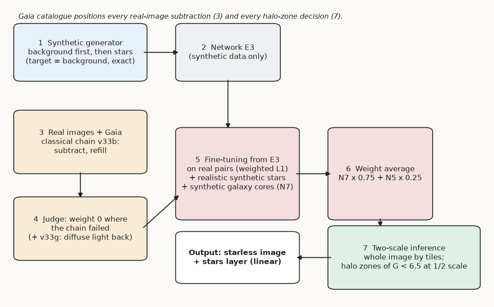

**Quick start** (Python 3.12, see [`requirements.txt`](requirements.txt); the weights are on the [Releases page](https://github.com/n1c1-1/float-star-removal/releases); the processor is enough, a few minutes for a 12-megapixel image):

```
pip install -r requirements.txt
cd modeles && sha256sum -c SHA256SUMS && cd ..          # after putting the .pt files of the release here
python scripts/inferer_une_image.py my_stack.fits --poids modeles/N7N5_075.pt --sortie output/
```

`my_stack.fits` must be a **linear** colour stack (calibrated, sky not stretched; mono images are not handled by this script). This command uses one scale: the tables below use the two-scale inference (Section 3.8), which also removes the halo of stars brighter than G 6.5 and needs the Gaia extract of the image (`scripts/Portée M27 – 25 nov/deux_echelles_v1v2.py`). The step-by-step version is in the [appendix](docs/TUTORIAL.md).

---

## 1. Introduction

**Problem.** In a deep-sky photograph the stars are brighter, sharper and more numerous than the faint structures the observer wants to process (nebulae, galaxies, dust). Separating them lets the observer stretch and colour the two layers independently. The task is *image decomposition on linear data*: from a linear image $I$ (sky background subtracted, each colour divided by the sky noise), find $S$ (starless) and $T = I - S \ge 0$ (the stars) without touching nebulae, galaxies or the background. Compact non-stellar objects (galaxy cores, planetary nebulae, small galaxies) are the hard part: they look like stars.

**Why networks need targets.** A network trained to output $S$ from $I$ needs pairs $(I, S_{\text{true}})$. Nobody owns the true starless version of a real photograph. The pairs therefore have to be made.

**The provenance question.** The easy way to make pairs is to run an existing star-removal tool on many images and train on its output. The resulting network then inherits the tool's errors and rights, and nobody outside can tell what it was trained on. Our requirement is the opposite: every target must come from a procedure that we can publish and that a third party can replay.

**Contributions.**

1. An open, replayable training recipe in which every target is either exact by construction (synthetic) or produced by a published classical chain (real), with a per-file provenance manifest, hash lists and a verification script (182 targets established, bit-identical replay of the tiles tried).
2. A Gaia-guided classical subtraction chain (v33b) and a rule-based judge that set weight 0 on failed zones instead of editing targets.
3. A diagnosis and a correction of a systematic target bias (subtracted star wings made the sky darker than the input) and a recipe of synthetic star and galaxy-core augmentation.
4. A two-scale inference that removes the halo of very bright stars beyond the receptive field of the network.
5. An evaluation protocol with five complementary measures, including a control set of compact galaxies and a saturated-star test, and a report of all discarded variants.

## 2. Related work

*Image restoration networks.* We use NAFNet (Chen, Chu, Zhang and Sun, *Simple Baselines for Image Restoration*, ECCV 2022 [1]), a U-Net without non-linear activation functions. Conditioning a restoration network on a known degradation is published practice: FFDNet gives it a noise-level map [2] and spatial feature transform layers modulate features by a spatial condition [3]; both are the models of our ongoing work (Section 8).

*Compact-source removal in astronomy.* Madarász et al. (*A Deep Neural Network Approach to Compact Source Removal*, A&A 696, A37, 2025 [4]) remove compact sources from Herschel images with a partial-convolution U-Net trained on simulated sources injected into real backgrounds. Our synthetic stars on real backgrounds follow the same principle on optical images; our target for real images is computed from a catalogue-guided subtraction.

*Catalogue-guided subtraction.* Observatory pipelines subtract bright stars with models of the extended star shape scaled to catalogue stars: the LSST bright-star subtraction pipeline review (Bazkiaei et al., arXiv:2404.04802, 2024 [5]) and the bright-star masks of the Hyper Suprime-Cam survey, built from Gaia and Tycho-2 (Coupon et al., PASJ 70, S7, 2018 [6]). Our chain v33b does the same with a star model measured on each image, then refills the residue.

*Existing star-removal tools* are closed image-to-image networks trained on undisclosed data. This is the gap addressed here: not accuracy, but an open training set whose origin is checkable.

*Catalogue.* Star positions and magnitudes come from Gaia DR3 (Gaia Collaboration, Vallenari et al., A&A 2023 [7]).

## 3. Method

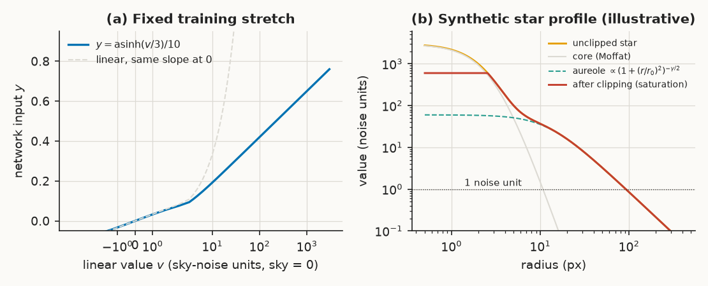

### 3.1 Data representation

Every image is **linear** and expressed in *noise units*: for each colour $c$, $v = (I_c - b_c)/\sigma_c$ with $b_c$ the sky level and $\sigma_c$ the sky noise (the gradient is removed beforehand, then the image is denoised with the host application's denoising network for most training images; raw inputs are also used, 25 % of the draws). The network never sees $v$ directly but a fixed stretch, undone exactly at the output (Figure above, panel a):

$$y = \frac{\operatorname{asinh}(v/3)}{10}, \qquad v = 3\,\sinh(10\,y).$$

The network predicts the starless image (its input plus a correction); the stars layer is $T = I - S$, so $S + T = I$ to the pixel.

### 3.2 Synthetic generator

**Idea.** The sky is drawn first, the stars are added second; the target is the sky itself. Backgrounds ([`scripts/backgrounds.py`](scripts/backgrounds.py), [`defects.py`](scripts/defects.py)): emission nebulae, Sérsic galaxies, reflection nebulae, dust, sky gradient and noise correlated between neighbouring pixels, plus stacking defects (mottling, vignetting, donuts, stacking edges). Stars ([`psf.py`](scripts/psf.py), [`stars.py`](scripts/stars.py)):

- core: the Fraunhofer PSF of a pupil with central obstruction and spider vanes, with Zernike aberrations (defocus, astigmatism, coma, trefoil, spherical) varying over the field, three colours, atmospheric Moffat profile $I \propto (1 + (r/\alpha)^2)^{-\beta}$, tracking trails, pixel binning ([8, 9, 10]; instruments drawn from 43 public telescope and lens sheets and 21 cameras, [`scripts/catalogue.json`](scripts/catalogue.json));
- aureole: $I(r) \propto \left(1 + (r/r_0)^2\right)^{-\gamma/2}$ with $\gamma \in [1.5, 2.6]$, holding 0.3 % to 5 % of the light; diffraction spikes, ghosts;
- counts: $N(>\text{peak}) \propto \text{peak}^{-\alpha}$, $\alpha \in [0.55, 0.75]$ (steeper above 100 noise units), 50 to 6000 stars per megapixel above one noise unit, from the star statistics of our own images;
- saturation per star and per colour; giants of Alnitak's class stay whole in the target when their reach exceeds 64 px (nothing is known under such a core, not even by hand).

The target is the background copied as is; the script [`exemples/generer_exemples.py`](exemples/generer_exemples.py) checks target equals background at every run and reproduces the examples bit for bit from seeds (hashes in [`exemples/EMPREINTES.txt`](exemples/EMPREINTES.txt)).

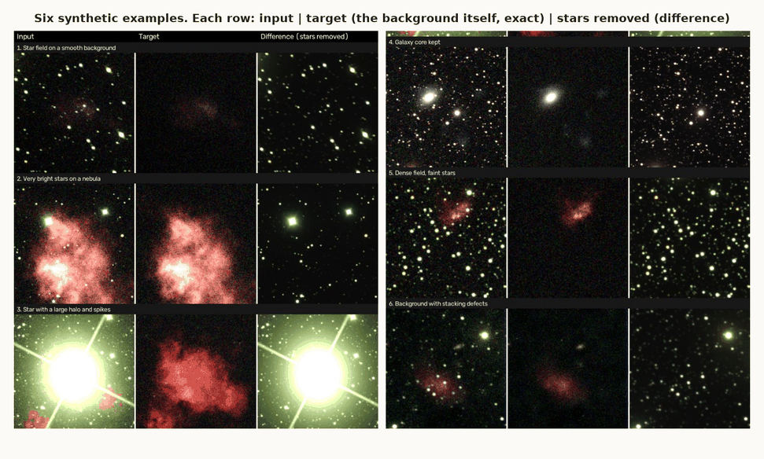

### 3.3 Gaia-guided classical subtraction for real images

Real images need real defects. For them, the target is computed by the chain v33b ([`scripts/Methode v33b – 23 nov`](scripts/), details in [`docs/METHOD.md`](docs/METHOD.md)).

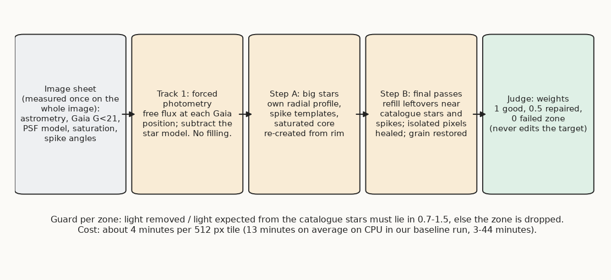

1. **Image sheet**, measured once on the whole image then frozen: plate solution, deep Gaia DR3 extract (to G 21, offline), and per colour the star width, flux scale, saturation plateau, an empirical star model (at least 30 isolated stars, radius 28 px, wings from the brightest) and the spike angles of the instrument.
2. **Track 1 (subtraction).** At each Gaia position only the flux is free (forced photometry). A star is subtracted if its flux exceeds 1.5 times its error; the position is fitted per colour when the peak exceeds 20 noise units; two stars are fitted jointly only if they differ by less than 2.5 magnitudes. Nothing is refilled.
3. **Step A (big stars).** A radial profile per star, an extended halo shape for $7 \le G \le 10.5$, spike templates at the instrument angles (±2°) followed to about 0.45 noise unit, saturated cores re-created from the smooth level of their rim plus sky grain.
4. **Step B (final passes).** Leftovers near catalogue stars and along known spikes are refilled; isolated 1-3 px outliers are healed; grain is restored in changed pixels; elongated residues (nebular filaments) are protected.
5. **Judge.** A pair is $(I, T, w)$. The weight is 1 for real pixels or well-refilled zones, 0.5 for judged repairs and **0 for failed zones** (rings, wrong level, islands, leftover stars, failed halos). The judge never edits the target. Rules: a target must never be brighter than the input (patch ≥ 25 px or excess > 5 noise units gives 0); a leftover compact peak above 20 noise units at a Gaia position gives 0 on a disc of radius $\max(2.5\ \mathrm{FWHM},\text{measured leftover})$ (cap 4 FWHM); halo radius measured by radial profile (cap 40 px); the largest stars (G ≲ 7) stay at weight 0 in real pairs and are learned from synthetic data.

Tiles are chosen by eye on content (nebula, galaxy, stars of all sizes), 3 to 5 tiles of 512 px per image, never black sky. The training set read by N5 and N7 has **182 pair files**: 103 denoised + 35 raw tiles + 6 held-out tiles (to choose snapshots) taken from our image library (54 files from Nicolas's own acquisitions, released; 90 from image banks, public data sets and online-telescope stacks of other authors, not released), and 38 tiles from 13 delinearised public web images (not redistributed).

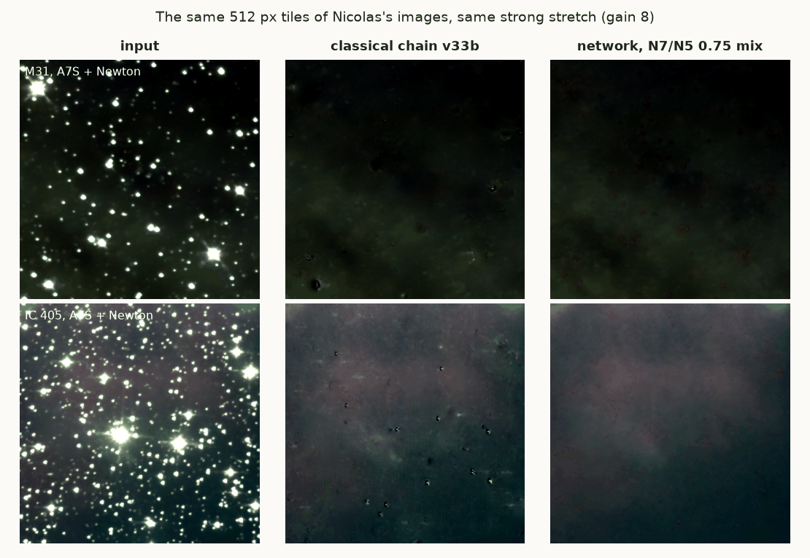

*Classical chain and network on the same 512 px tiles of two of Nicolas's images (display gain 8, much stronger than for the input column of an ordinary view, to reveal residues). Small dark dots remain in the classical result of IC 405.*

### 3.4 Target correction v33g and weights

Diagnosis (25 Nov): track 1 subtracts the model of *every* catalogue star, wings included up to 150 px, even in zones the judge keeps. The targets were therefore darker than the input in the diffuse sky, and the network learned to erase smooth diffuse light (the disc of M31, the core of M65/M66). Correction: let $D = I - T$, $M$ the weight-class-0 pixels (untouched) outside discs of stars $G < 8$, $L$ the normalised Gaussian smoothing of $D$ over $M$ ($\sigma = 40$ px, per channel, four rounds of clipping of pixels beyond 2.5 robust deviations); the corrected target is $T' = T + L$. The median of $I - T$ over $M$ goes from $+0.12$ to $-0.05$ noise unit.

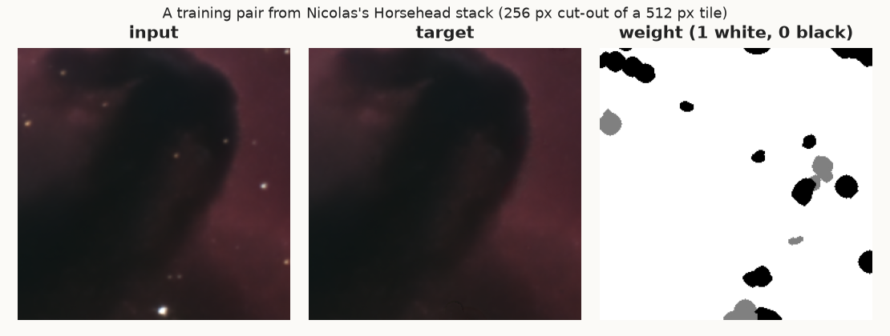

### 3.5 Network and training

NAFNet, width 32, encoder blocks 2-2-4-8, 12 middle blocks, decoder 2-2-2-2 ([`scripts/models.py`](scripts/models.py)), residual output, 256 px tiles, batch 8, loss $L = \sum_p w_p\,|f(\hat S_p) - f(S_p)| \big/ \sum_p w_p$ on the stretched images $f$ ($w$ the weight map, 1 for synthetic tiles). AdamW-type schedule, learning rate $5\times 10^{-4}$ (1 000 warm-up steps, then cosine), 34 500 steps (about 5 h on one 16 GB card). Each tile is drawn from the real pairs (40 %: 50 % denoised, 25 % raw, 25 % web) or generated on the fly (60 %), where half of the generated tiles receive one or two imposed very bright stars (peak 300 to 300 000 noise units, large halo, spikes) on a real background. All networks N* start from E3 (step 20 000), itself trained on synthetic data only (7-9 Nov). The snapshot kept is the one with the lowest loss on the star footprint of 6 held-out real tiles (N5: step 23 000, N7: step 22 000).

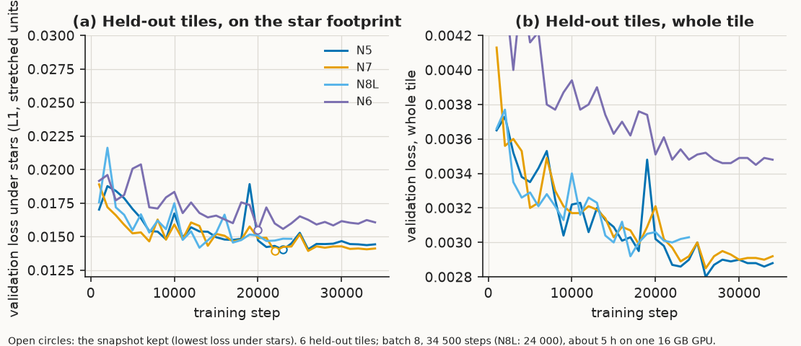

*Open circles: snapshot kept. After about 22 000 steps the held-out loss is flat (N8L, a 24 000-step run, did not improve on N7).*

### 3.6 Synthetic galaxy cores (N7)

N5 erases galaxy cores: the flux at M31's nucleus goes from 369 to 5-7, although E3 (synthetic data only, which already contained galaxy cores) keeps it (E3 mean core ratio 0.68). Hypothesis: in the real pairs a compact bright object is almost always a star, so the network learns that compactness means star; N7 adds explicit examples of compact objects to keep. N7 adds, in 25 % of the synthetic tiles, one or two cores (Sérsic index 1-4, effective radius 4-60 px, ellipticity 0-0.6, peak 50-5 000 noise units, 30 % clipped, yellow-white galaxy or blue-green planetary nebula, FWHM at least 2.5 times that of the tile's stars), identical in input and target at weight 1.

### 3.7 Weight averaging

For two networks A and B that start from the same point (E3), $\theta = a\,\theta_A + (1-a)\,\theta_B$ over the 664 floating-point tensors (integer buffers from A). It needs no data and no training. Between different starting points this was not tried.

### 3.8 Two-scale inference

The receptive field of the network (about 180 px) is smaller than the halo of the brightest stars (285 px for G 5.6 on M27): they became a flat grey-blue disc, and larger tiles did not help. For every Gaia star of $G < 6.5$ we measure the halo radius $R$ in the input (first radius where the median radial profile minus the local background falls below 2 noise units, cap 300 px). Inside $R$ the output is that of the network applied to the image reduced by 2 and enlarged back; the blend is 1 up to $0.7R$ then a cosine to 0 at $R$. The replaced part of the image is 12.6 % for M42 (49.5 % with a flux-based radius formula).

## 4. Evaluation protocol

### 4.1 The 13 validation images

Never seen in training (image preparation identical to the training one). They were used to compare variants and to choose the mix weight, so they are a development set, not an independent test set; only the snapshot step was chosen on held-out training tiles. No validation image is redistributed; two are Nicolas's own and are shown in Section 5.

| image | target | camera and optics | scale (″/px) | star FWHM (px) | tests |
|---|---|---|---|---|---|
| m31_a7s_newton | M31 | modified full-frame hybrid, Newtonian 130/900 | 1.28 | 4.5 | spider spikes, very bright galaxy core |
| ic405_a7s_newton | IC 405 | same | 1.28 | 4.7 | spikes on bright stars in a nebula |
| m33_osc_lunette | M33 | colour camera ASI294MC Pro, 350 mm refractor | 1.81 | 3.9 | no spikes, HII regions |
| m27_mono_nb | M27 | mono ASI1600MM, Newtonian 1325 mm, Ha/OIII/SII | 0.59 | 4.1 | compact planetary, 3 assembled filters |
| ngc3372_mono_nb | NGC 3372 | 0.4 m online telescope, Ha+OIII | 0.74 | 6.5 | dense Milky Way, very bright star |
| m16_seestar_s50 | M16 | Seestar S50, 250 mm | 1.58 | 4.1 | small instrument, short stack |
| ngc6934_stellina | NGC 6934 | Stellina, 400 mm | 1.24 | 4.4 | globular cluster, saturated core |
| leotriplet_canon6d_newton | Leo triplet | DSLR Canon 6D, Newtonian 200/1000 | 1.35 | 7.4 | spikes, M65/M66 cores |
| m31_canon60d_objectif_filee | M31 | DSLR Canon 60D, 200 mm lens, unguided | 4.56 | 3.6 | trailed stars, wide galaxy, M31/M32 cores |
| m42_canon40da_lunette | M42 | DSLR Canon 40Da, 72ED refractor | 2.73 | 4.4 | Trapezium, bright-star halos |
| ic5146_canon60da_lunette | IC 5146 | DSLR Canon 60Da, refractor | 2.0 | 4.4 | star field + diffuse nebula |
| m42_dobson_grande_fwhm | M42 | ASI533MC Pro, 12-inch Dobsonian | 0.51 | 11.9 | very wide stars: everything changes scale |
| ic1848_stellina | IC 1848 | Stellina, 400 mm | 1.24 | 3.6 | faint nebula in a rich field |

(The list in `scripts/Validation – 22 nov/liste.py` has a fourteenth entry, NGC 7822, replaced by IC 1848 because the Gaia query for a 7.5° field was too slow; the 13 above are the images with a Gaia extract.)

### 4.2 Metrics

*Residual stellar flux.* For each Gaia star $i$ of magnitude $G_i$ and each image, with $A_i$ the aperture of radius $2\,\mathrm{FWHM}$ and the background $B$ the median of the annulus $3$-$5\,\mathrm{FWHM}$ of the same image:

$$\rho_i = \frac{\sum_{A_i}\,(\text{out} - B_{\text{out}})}{\sum_{A_i}\,(\text{in} - B_{\text{in}})}$$

($\rho = 0$: star removed; $\rho = 1$: intact). Stars are grouped in five bands of $G$ (below 8, 8-11, 11-14, 14-17, above 17). The tables report, per band, the **share of stars with $\rho > 0.1$** (mean over the images having at least 5 stars in the band); the median of $\rho$ is also stored in the per-image files and is near 0 for the first three bands. 147, 2 205, 9 997, 12 177 and 8 409 stars fill the five bands over the 13 images. Above G 17 most stars are below the noise: there is little to remove.

*Background damage.* Median and 99th percentile of $|\text{out} - \text{in}|$ (mean of the three colours, input noise units) over the pixels farther than $\max(4\ \mathrm{FWHM}, r_G)$ from any detectable Gaia star. 0.001 means a thousand times below the noise: invisible. The same median is computed on the bright structure (input smoothed, above its 90th percentile): *structure damage*.

*Core preservation.* $Q = \sum_{r\le 15}\text{out}\,/\sum_{r\le 15}\text{in}$ in a 15 px disc around each of six galaxy cores (M31 and M32 on two images, M65 and M66 on a third), averaged. Ideal: 1.

*Compact-galaxy control (numbers only).* 18 small galaxies (1.2 to 2.8 times the star FWHM), absent from Gaia, found automatically then chosen by eye in 5 web images; ratio out/in in a 3 px disc (background: annulus 24-40 px), for the galaxy (ideal 1) and for the Gaia star of the same brightness (ideal 0). No pixel of these third-party images is published. The set is used only to judge, never to tune or train.

*Saturated faint stars (Horsehead).* Residual flux in a 2 FWHM disc around six saturated stars of a short-exposure image (flat top at about 100 noise units), and two high-signal validation stars for comparison.

All measures are made with the script [`scripts/Validation – 22 nov/valider_reseau.py`](scripts/) and the two-scale inference. The validation and control images were never part of the training pairs (checked file by file).

## 5. Results

### 5.1 Main table

Whole validation images, two-scale inference, 13 images. Lower is better except the core column (ideal 1).

| model | stars G<8 | G 8-11 | G 11-14 | G 14-17 | G >17 | background median | background p99 | structure median | cores |
|---|---|---|---|---|---|---|---|---|---|
| E3 (synthetic data only) | 0.040 | 0.080 | 0.124 | 0.341 | 0.606 | 0.0116 | 0.05 | 0.018 | 0.680 |
| N2 (real pairs v33d, 26 000 steps) | 0.000 | 0.013 | 0.091 | 0.313 | 0.581 | 0.0015 | 0.12 | 0.005 | not measured |
| N5 (v33g targets) | 0.000 | 0.017 | 0.072 | 0.265 | 0.551 | 0.0011 | 0.07 | 0.007 | 0.192 |
| N7 (N5 + synthetic cores) | 0.021 | 0.020 | 0.094 | 0.283 | 0.571 | 0.0023 | 0.03 | 0.004 | 0.813 |
| N7 / N5 0.75 mix | 0.021 | 0.023 | 0.090 | 0.295 | 0.584 | 0.0018 | 0.03 | 0.003 | 0.798 |

Star columns: share of stars keeping more than 10 % of their flux, mean over the images that have at least 5 stars in the band (each image weighs the same). Pooled over stars instead (number of stars above 10 % / stars):

| model | G<8 | G 8-11 | G 11-14 | G 14-17 | G >17 |
|---|---|---|---|---|---|
| E3 | 7 / 144 | 40 / 2 205 | 703 / 9 997 | 3 349 / 12 177 | 4 940 / 8 409 |
| N5 | 0 / 144 | 13 / 2 205 | 359 / 9 997 | 2 463 / 12 177 | 4 530 / 8 409 |
| N7 | 4 / 144 | 15 / 2 205 | 422 / 9 997 | 2 699 / 12 177 | 4 707 / 8 409 |
| N7 / N5 0.75 | 4 / 144 | 16 / 2 205 | 428 / 9 997 | 2 855 / 12 177 | 4 820 / 8 409 |

The G < 8 column rests on 144 stars in 11 images (8 of them have the 5 stars needed to enter the image mean): the difference between 0 and 0.021 is four stars, with no uncertainty estimate (one network per variant, no seeds). Source files: [`docs/figures/SOURCES.md`](docs/figures/SOURCES.md).

**Reading.** Real pairs improve on synthetic data alone mostly at the faint end and on background damage (E3 is 5 to 10 times worse on the background). N5 is the best at stars. N7 and the mix keep galaxy cores (0.80 on average; the compact core of M32 on the Canon 60D stays at 0.04) and gain on structure damage and p99, at the cost of four bright stars out of 144 and slightly more faint stars. There is no best model, only a trade-off (Section 5.3).

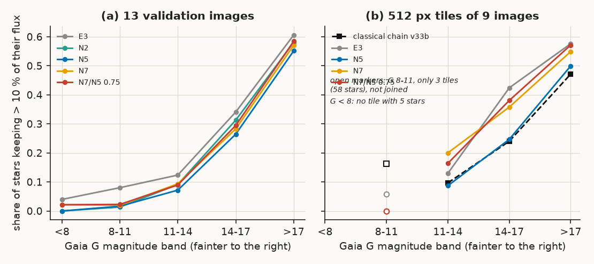

### 5.2 Classical baseline (subset of crops)

The classical chain v33b is our reference method. It costs about 4 minutes per 512 px tile on a graphics card for its subtraction stage and 13 minutes on average on processor only in this run (3 to 44 minutes): measuring it on the 13 whole images is not feasible, so it is measured on **one 512 px tile per image, 9 of the 13 images** (the first 9 in list order; time budget; the four others were never attempted). The tile of each image is the one, on a 128 px grid, with at least 95 % valid pixels and at least 128 px from the border, that contains most Gaia stars with $8 \le G < 17$ (rule written before the runs; [`docs/figures/data/baseline_tile_choice.json`](docs/figures/data/baseline_tile_choice.json)). The networks are evaluated on the same tiles, one scale, on a 1280 px window around the tile, processor only. The whole run, including one-off per-image calibration, took 3 h 40 on 4 threads (about 40 minutes over the 3 h allowed); its code is in [`scripts/Baseline classique – 26 nov/`](scripts/).

| source (9 tiles) | G 8-11 (3 tiles) | G 11-14 | G 14-17 | G >17 | background median | background p99 |
|---|---|---|---|---|---|---|
| classical chain v33b | 0.163 | 0.097 | 0.240 | 0.471 | 0.0014 | 0.10 |
| E3 | 0.059 | 0.130 | 0.424 | 0.576 | 0.0211 | 0.05 |
| N2 | 0.000 | 0.130 | 0.304 | 0.531 | 0.0029 | 0.06 |
| N5 | 0.000 | 0.087 | 0.247 | 0.499 | 0.0044 | 0.06 |
| N7 | 0.000 | 0.200 | 0.358 | 0.549 | 0.0034 | 0.02 |
| N7 / N5 0.75 | 0.000 | 0.164 | 0.381 | 0.571 | 0.0035 | 0.02 |

**Reading, with the limits.** On these tiles the classical chain is as good as the best network (N5) on faint stars and better than N7 and the mix; its background damage has a lower median (0.0014 against 0.003-0.021) but a higher 99th percentile (0.10 against 0.02-0.06). It is about 17 times slower (13 minutes against 45 seconds per tile and model, both at 4 threads; the networks need 13 s for a whole image on a graphics card). The tiles contain almost no stars brighter than G 8 (3 stars in all) and only 58 between G 8 and 11: **this comparison says nothing about bright stars**, which are where the chain's own judge gives up (the largest stars are at weight 0 in the pairs). The tile rule favours dense fields, hence faint stars. The networks run here on crops in one scale, so their numbers are not comparable with the whole-image table above (N7 at G 14-17: 0.358 here, 0.283 on whole images). ngc3372_mono_nb is poor for every method (0.52 at G 14-17 for the chain). Two further biases favour the chain: the metric is computed at Gaia positions, which is where the chain subtracts by forced photometry (stars absent from Gaia are not measured), and the chain produced the networks' training targets, so it is scored on its own criterion. Differences of a few hundredths (0.240 against 0.247 on about 94 stars per tile) carry no uncertainty estimate: "as good as" is what the data support, "better than N7 and the mix" only weakly. In figure 8b the point at G 8-11 rests on three tiles (58 stars) and is not joined to the others. We read the result this way: the network is a fast approximation of its teacher, which it matches on faint stars and exceeds only where the teacher was told to ignore (very bright stars); it does not exceed the teacher on the measures made here.

### 5.3 Ablation: what was tried and discarded

Rows for 13 images, two scales unless noted. Stars: share keeping more than 10 %. Cores: flux ratio (ideal 1).

| variant | what changed | G<8 | G 14-17 | background median | cores | verdict and why |
|---|---|---|---|---|---|---|
| N6 | v33h weights: faint stars repaired → 1, leftovers > 10 % → 0 | 0.000 | 0.351 | 0.0027 | 0.104 | worse on faint stars, background; abandoned |
| N7 / N5 0.5 | weight average | 0.000 | 0.296 | 0.0016 | 0.653 | halfway on cores |
| N7 / N6 0.5 | weight average | 0.012 | 0.312 | 0.0019 | 0.651 | no gain |
| N5 / N6 0.5, 0.75 | weight averages | 0.000 | 0.327, 0.300 | 0.0017, 0.0011 | 0.133, 0.158 | the erased core stays erased |
| N5 + slow-part restoration (σ 40, σ 80) | smoothed diffuse light added at inference | 0.000 | 0.265 | 0.0026, 0.0032 | 0.178 | cores unchanged, background worse |
| N8 (steps 5 000 / 10 000), 10 % cores | fewer synthetic cores | 0.052 | 0.298, 0.331 | 0.0038, 0.0011 | 0.837, 0.785 | cores ≈ 0.8 whatever the share |
| N8L (steps 13 000 / 24 000) | same, longer | 0.052 | 0.294, 0.310 | 0.0027, 0.0008 | 0.792, 0.807 | no better than N7 |
| N9 (10 000 steps), 40 % compact cores | cores 1.3-1.5 FWHM, Sérsic n 3-6 | 0.136 | 0.348 | 0.0011 | 0.869 | M32 (60D) 0.05 → 0.26 but bright stars kept |
| N10 (10 000 steps) | variant of N9 | 0.052 | 0.346 | 0.0011 | 0.816 | no better than N7 |
| N3, N4 | synthetic halos up to 285 px, judge variants | 0.000 | 0.31 | 0.0011-0.0026 | not measured | M27 disc unchanged: the limit is the receptive field, not the data (one scale) |

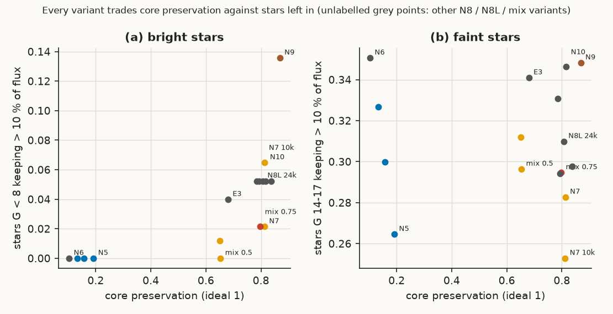

Every variant lies on one trade-off: more core preservation, more stars left in. The reason (Section 6) is that a saturated faint star and a compact core resemble each other.

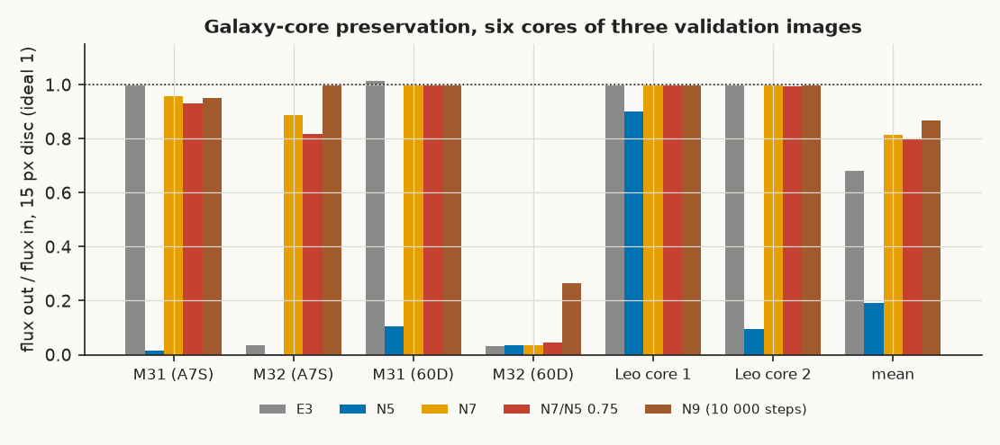

### 5.4 Compact galaxy control

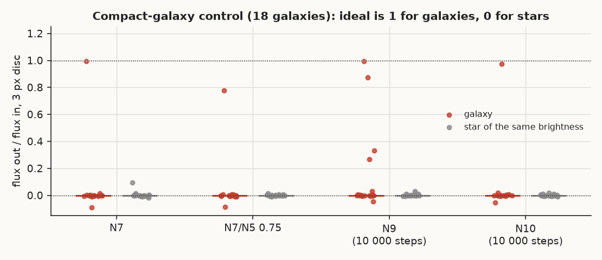

Medians over 18 galaxies, flux ratio in a 3 px disc (galaxy / star of the same brightness): N7 −0.002 / −0.002; N7/N5 0.75 −0.001 / −0.002; N9 and N10 also near 0 ([`docs/figures/data/control.json`](docs/figures/data/control.json)). **Every model erases almost every small compact galaxy**, as it erases the star of the same brightness: a single galaxy (the diffuse one) stays with N7, the mix and N10, four stay with N9 (0.27 to 0.99), which also keeps more stars. Shape alone does not separate them.

### 5.5 Whole images (Nicolas's own)

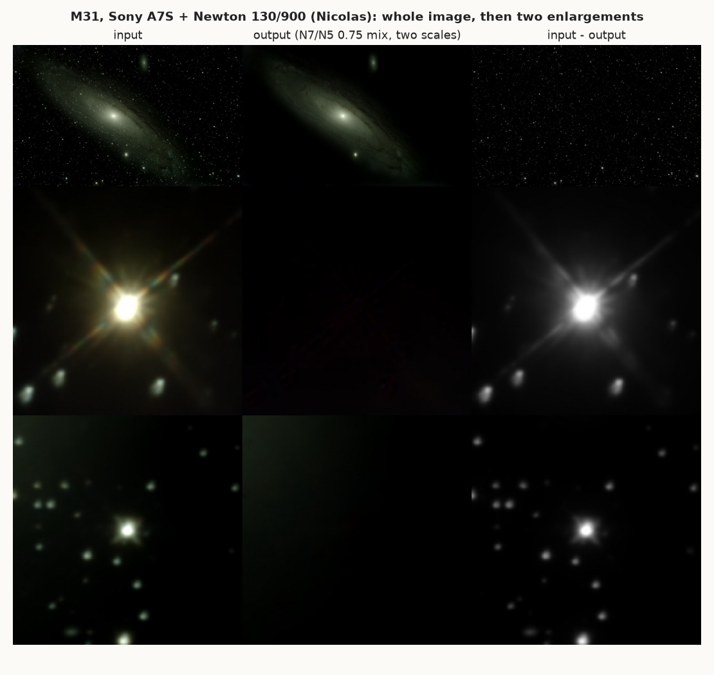

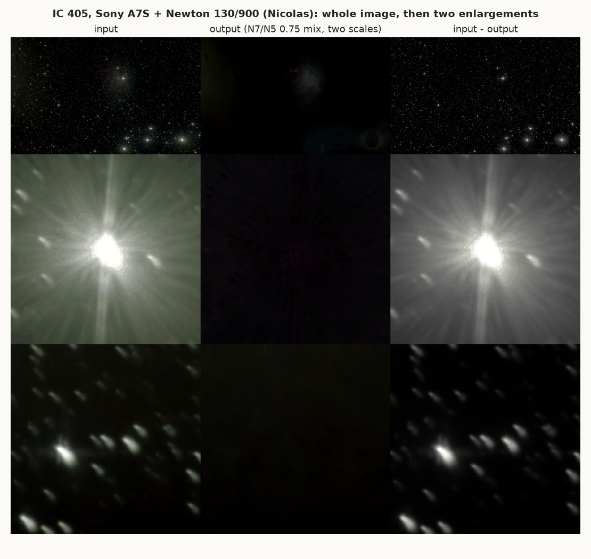

## 6. Limitations and failure analysis

**Saturated faint stars are taken for galaxy cores.** On Nicolas's Horsehead stack (704 exposures of 15 s, not denoised, with Alnitak), several stars have a flat top at about 100 noise units. A synthetic core of N7 is exactly that: a clipped compact peak of 50-5 000 noise units. N7 and the mix therefore keep these stars.

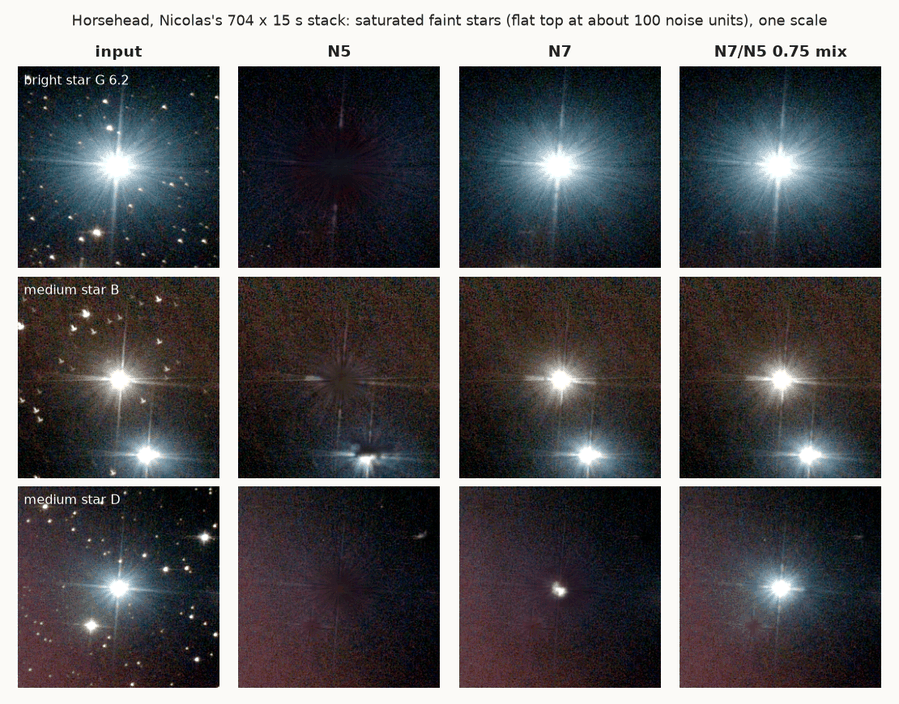

*One-scale outputs of N5, N7 and the mix, same display, on three stars (columns: input, N5, N7, mix). N5 removes the stars (it also leaves the secondary star of the second row partly in); N7 and the mix keep them. The stars are saturated at about 100 noise units. N5 is not clean either: it leaves a dark disc and a small leftover blob in the second row.*

Residual flux in a 2 FWHM disc (0 removed, 1 intact), one scale:

| star | peak (noise units) | E3 | N5 | N7 | mix 0.75 |
|---|---|---|---|---|---|
| G 3.79 | 109 | 0.98 | 0.99 | 0.98 | 0.98 |
| G 6.18 | 106 | 0.99 | 0.00 | 0.97 | 0.99 |
| medium A | 108 | 1.00 | 0.01 | 0.97 | 0.99 |
| medium B | 110 | 0.01 | 0.03 | 0.95 | 0.97 |
| medium C | 101 | 0.97 | 0.00 | 0.95 | 0.95 |
| medium D | 97 | 0.01 | 0.01 | 0.11 | 0.95 |
| IC 405 G 4.1 (validation) | 12 536 | 0.01 | 0.00 | 0.00 | 0.00 |
| IC 5146 G 6.4 (validation) | 860 | 0.00 | 0.00 | 0.00 | 0.00 |

(Source: [`docs/figures/data/horsehead_results.json`](docs/figures/data/horsehead_results.json).) With the two-scale inference at ×2 N5 removes all six (0.00-0.02; diagnostic table `tableau.md` of the Horsehead run). At high signal every model removes the star. Raising the input gain (×4, ×8) repairs only the three faintest cases, denoising the input has no effect, and the two-scale option at ×2 only partly helps. **Our validation set contained no saturated star at this level (860 to 12 500 noise units only), so the main table did not show the defect.** The diagnosis of the primary cause is reasonably established (N7 keeps these stars because its synthetic cores include clipped peaks); secondary causes (very bright stars absent from Gaia, Alnitak being one; scarcity of raw short-exposure inputs in training) are hypotheses.

**Small galaxies erased.** See Section 5.4: median flux kept ≈ 0 for the galaxy and the star alike. Synthetic cores raise M32 from 0.05 to 0.26 at most (N9) and cost bright stars.

**Faint stars (G 14-17).** For N5, N7 and the mix, 26 % to 30 % (image mean; 20 % to 23 % pooled over stars) keep more than 10 % of their flux. In the training pairs 52 to 64 % of G 14-17 stars have weight 0 at their centre (the judge could not guarantee them), so they are not taught. Giving them more weight (N6) made things worse.

**Under a saturated core the truth does not exist.** The target there is a plausible refill, not reality: the largest stars are learned mostly from synthetic data.

**Other caveats.** The validation images were denoised with the host application's denoising network, so the metrics do not describe raw inputs. The evaluation uses Gaia positions, so it does not measure stars that are absent from the catalogue. Thirteen images are few; one network per variant was trained, so we have no variance across seeds. The comparison with the classical chain covers 9 tiles (Section 5.2).

## 7. Provenance and reproducibility

**Provenance.** [`provenance/MANIFESTE_PAIRES.csv`](provenance/MANIFESTE_PAIRES.csv) lists the 182 pair files read by N5 and N7 with, for each, its origin chain, scripts and commits, input and pair hashes, and a verdict. **182 targets are established**: 131 from chain v33 and 51 from v33b (38 web pairs included), then v33d (weights only) and v33g (smoothed diffuse light); the 35 raw pairs are `raw − (denoised input − denoised target)`. No target comes from a network output, a hand retouch or third-party software. Three proofs are given ([`docs/PROVENANCE.md`](docs/PROVENANCE.md)): production logs, a numerical check on 60 tiles whose image folder contained a neighbouring starless file (the target equals it on at most 0.42 % of the differing pixels; a derived target would give 100 %), and a **bit-identical replay** of the target from the input on the tiles tried (6 in section 2 bis of that document, listed in its section 4, one of them a web pair). A static analysis of the import closure of the training scripts finds no read of third-party outputs or weights ([`provenance/STATIC_ANALYSIS.md`](provenance/STATIC_ANALYSIS.md)). One doubt: the web images were processed by their authors with unknown software before we received them; that is in the input, not in the target.

**Release assets** (v1.0, [Releases page](https://github.com/n1c1-1/float-star-removal/releases)), each with its sha256 in the release notes and in [`modeles/SHA256SUMS`](modeles/SHA256SUMS): `E3_step_20000.pt`, `N5_pas_23000.pt`, `N7_pas_22000.pt`, `N7N5_075.pt`, `paires_nicolas.zip` (the 54 training pairs made from Nicolas's images), `rejeu_entrees_nicolas.zip` (inputs, astrometry, star model and Gaia extracts to redo these targets).

**Can a third party rerun each result?**

| result | what is needed | status |
|---|---|---|
| synthetic examples (Fig. 3) | repository only | bit-exact from seeds ([`exemples/`](exemples/)) |
| provenance verdict of Nicolas's pairs | release pairs and replay inputs | `provenance/verifier_provenance.py` (hashes, relations, replay) |
| web pairs | network access to the public pages | `provenance/refaire_paires_web.py` (checksums in the manifest) |
| training of N5, N7 | the 182 pairs (web ones rebuilt from their pages), a 16 GB GPU | scripts and recipes published; the full training was not re-run by a third party |
| validation tables | the 13 validation images, which are **not** redistributed, plus their Gaia extracts | scripts published; a third party must supply images of their own and will obtain their own numbers |
| compact-galaxy control | five web images (listed in [`docs/WEB_SOURCES.md`](docs/WEB_SOURCES.md)) | not redistributed |
| baseline on crops | the validation images and the chain's per-image calibration | scripts and `docs/figures/data` numbers published |
| the figures | `docs/figures/data` (published) | `python docs/figures/make_figures.py` redraws all of them |

Parts that depend on the host application (offline plate solving, local catalogue reader, denoising network) are not provided ([`scripts/README.md`](scripts/README.md)); inference does not depend on them. Every number of this paper is traced to a file in [`docs/figures/SOURCES.md`](docs/figures/SOURCES.md).

## 8. Ongoing work (26 November 2026)

The measured limits all come from the same ambiguity, which pixels alone cannot resolve: a saturated star and a compact core look alike. The Gaia catalogue can: saturated stars are in it, galaxy nuclei are not (they have no measured proper motion in Gaia). We are testing (no result claimed here):

1. **Gaia star map as network guidance**: first as an extra input channel, then as spatial modulation of the network's features (in the manner of [3]), the map being drawn from the catalogue positions and magnitudes (G ≤ 14) with a proper-motion filter.
2. **An offline catalogue extract G ≤ 14** with that filter, so that the application needs no network access.

## 9. Chronology and repository contents

The experiments ran from 7 to 9 November 2026 (E2, E3) and from 20 to 26 November 2026 (classical chain, real pairs, N2 to N10). The history of the failed attempts is in [`docs/LESSONS.md`](docs/LESSONS.md), the improvement paths and how to measure them honestly in [`docs/IMPROVING.md`](docs/IMPROVING.md), the method in detail in [`docs/METHOD.md`](docs/METHOD.md), the evaluation in [`docs/VALIDATION.md`](docs/VALIDATION.md).

| folder | content |
|---|---|
| `docs/` | METHOD, LESSONS, VALIDATION, PROVENANCE, TUTORIAL (step-by-step appendix), IMPROVING, WEB_SOURCES, `figures/`, `images/` |
| `scripts/` | every script really used (folder names keep the original French and date for traceability), with a README mapping scripts to steps |
| `exemples/` | reproducible synthetic example generation |
| `modeles/` | fingerprints and download notes of the models |
| `provenance/` | manifest of the training pairs, verifiers, static analysis |
| `prompts/` | the instructions given to the agents (historical record, original language) |
| `resultats/` | cleaned result tables |

## References

1. L. Chen, X. Chu, X. Zhang, J. Sun, *Simple Baselines for Image Restoration* (NAFNet), ECCV 2022, arXiv:2204.04676.
2. K. Zhang, W. Zuo, L. Zhang, *FFDNet: Toward a Fast and Flexible Solution for CNN-Based Image Denoising*, IEEE Trans. Image Processing, 2018, arXiv:1710.04026.
3. X. Wang, K. Yu, C. Dong, C. C. Loy, *Recovering Realistic Texture in Image Super-resolution by Deep Spatial Feature Transform* (SFT), CVPR 2018, arXiv:1804.02815.
4. M. Madarász, G. Marton, I. Gezer, et al., *A Deep Neural Network Approach to Compact Source Removal*, Astronomy & Astrophysics 696, A37, 2025, arXiv:2502.18345.
5. A. E. Bazkiaei, L. S. Kelvin, S. Brough, S. J. O'Toole, A. Watkins, M. A. Schmitz, *Bright Star Subtraction Pipeline for LSST: Progress Review*, 2024, arXiv:2404.04802.
6. J. Coupon et al., *The bright-star masks for the HSC-SSP survey*, Publications of the Astronomical Society of Japan 70, S7, 2018, arXiv:1705.00622.
7. Gaia Collaboration (A. Vallenari et al.), *Gaia Data Release 3: Summary of the content and survey properties*, Astronomy & Astrophysics, 2023, arXiv:2208.00211.
8. J. Rowe et al., *GalSim: The modular galaxy image simulation toolkit*, Astronomy and Computing 10, 121, 2015 (optical PSF by Fraunhofer diffraction).
9. R. J. Noll, *Zernike polynomials and atmospheric turbulence*, J. Opt. Soc. Am. 66, 207, 1976.
10. A. F. J. Moffat, *A theoretical investigation of focal stellar images in the photographic emulsion and application to photographic photometry*, Astronomy & Astrophysics 3, 455, 1969; R. Racine, *The telescopic point-spread function*, PASP 108, 699, 1996.

## Licence

Copyright (C) 2026 Nicolas.

Code, documents, figures and models: **GNU Affero General Public License v3.0** (full text in [`LICENSE`](LICENSE), summary in [`NOTICE`](NOTICE)).
The model weights (.pt files) are part of the Program covered by this licence. Any software that loads, embeds or serves these weights, locally or over a network, is a work based on the Program and must be released under the AGPL-3.0.
The intent is that every application using these models is free software.
Web images cited in `docs/WEB_SOURCES.md` belong to their authors and are not redistributed.

## How to cite

See [`CITATION.cff`](CITATION.cff):

> Nicolas (2026). *Removing stars from linear astronomical images with a network trained without any third-party star remover.* https://github.com/n1c1-1/float-star-removal
